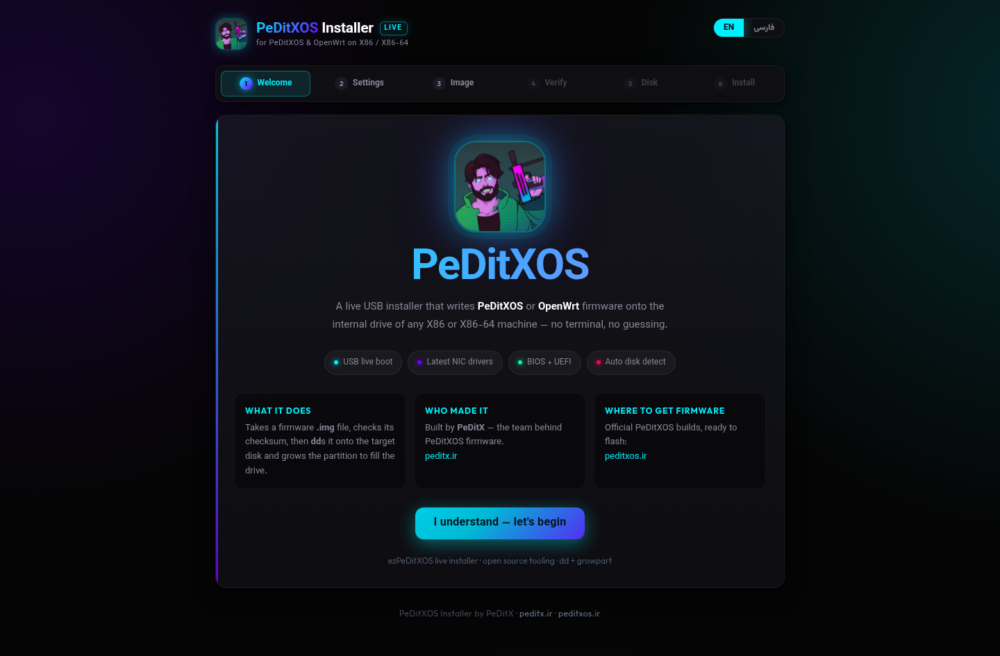
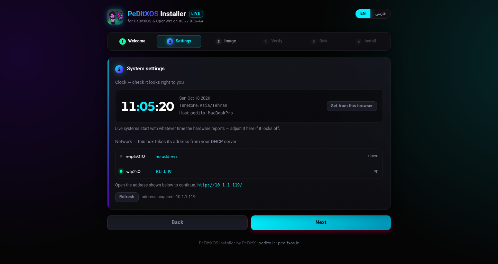
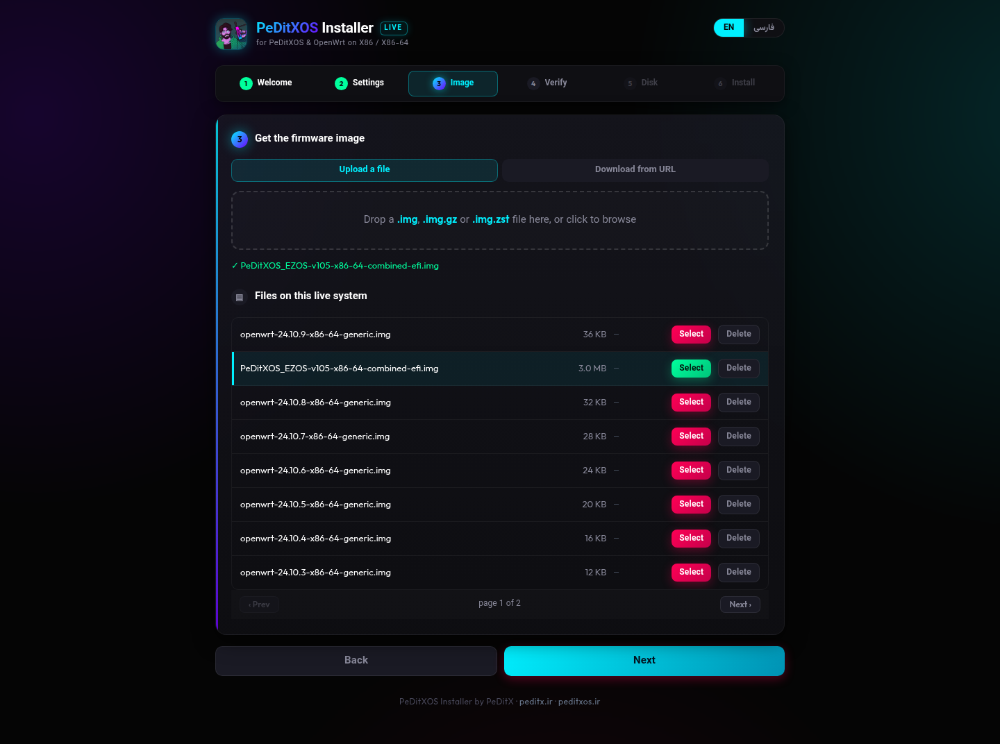
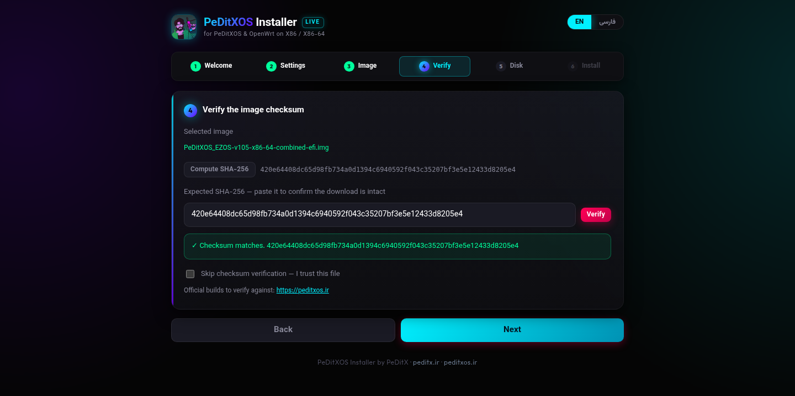
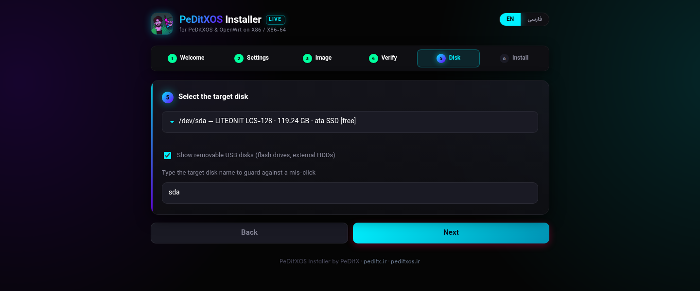
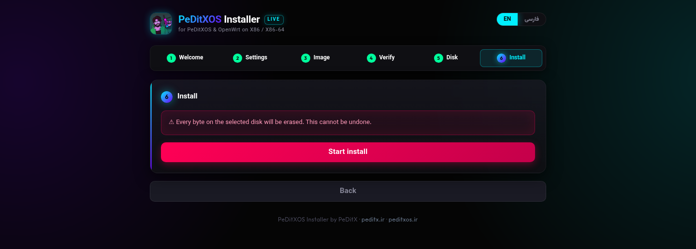
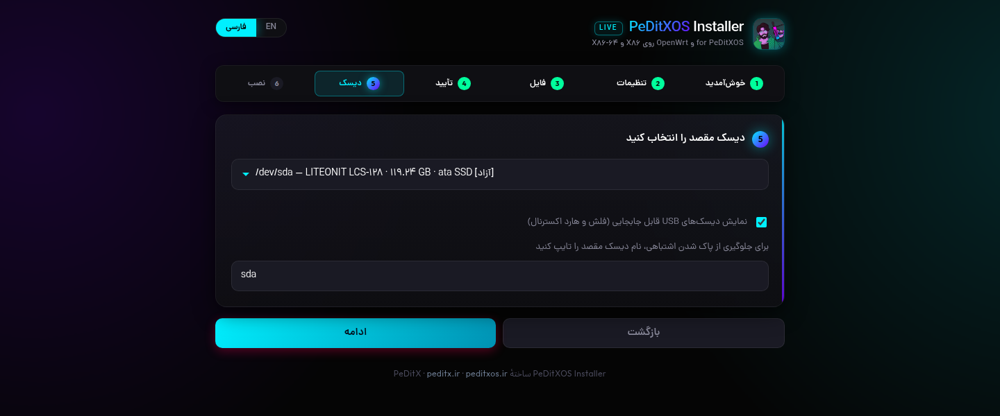
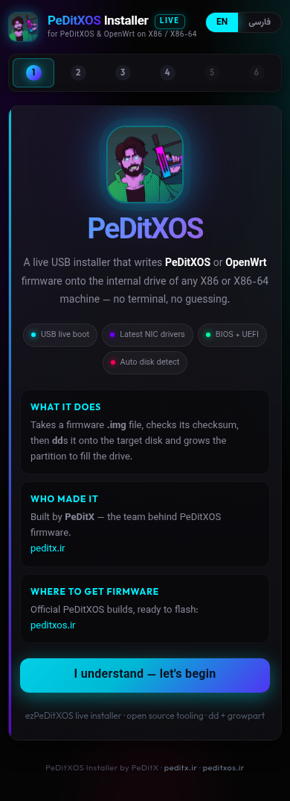

<p align="center">
  
</p>

# ezPeDitXOS

A Debian-based **live USB installer** that flashes **PeDitXOS** / OpenWrt firmware
onto the internal drive of an X86 or X86-64 machine from a web page.

Boot the stick → open `http://<ip>/` → upload or paste a link to a `.img` →
check its SHA-256 → pick the target disk → `dd` + grow.

[فارسی](README-fa.md)

## Screenshots

The whole installer is one six-step wizard. English by default, فارسی from the
switch in the top bar — the layout flips to RTL and the Dana font takes over.

| | |
|---|---|
|  |  |
| **1 · Welcome** — what this is, who built it, where firmware comes from | **2 · Settings** — clock and NICs, so a wrong date is visible before flashing |
|  |  |
| **3 · Image** — upload, download from a URL, or pick a file already on the stick (paginated) | **4 · Verify** — streamed SHA-256 against the expected hash, or skip |
|  |  |
| **5 · Disk** — every disk with size / model / transport; type the name to arm the button | **6 · Install** — `dd` with live progress and a log, then grow the partition |

The same screen in Persian, and the welcome page on a phone:

| | |
|---|---|
|  |  |
| RTL layout, DanaFaNum, Latin device names stay LTR | One column, no horizontal scroll, same theme |

## Build

```bash
./build.sh --check   # see what this machine is missing
sudo ./build.sh      # builds build/ezPeDitXOS-installer-amd64.hybrid.iso
```

`lb config` runs as your normal user. Only `lb build` needs root, because
`debootstrap` has to `mknod` device nodes inside the chroot — a user namespace
cannot do that, so `unshare -r` is not a substitute for `sudo`.

Prerequisites (`build.sh` installs them itself unless you pass `--no-deps`):
`debootstrap squashfs-tools xorriso mtools dosfstools rsync git`.

`live-build` is taken from apt when it is a current release; Ubuntu still
ships the old `3.0~a57` fork, in which case the script clones the Debian
one into `.tools/` instead.

## Flash to USB

```bash
sudo dd if=build/ezPeDitXOS-installer-amd64.hybrid.iso of=/dev/sdX bs=4M status=progress conv=fsync
```

`/dev/sdX` is the whole stick, never a partition. The image is isohybrid:
the same file boots legacy BIOS and UEFI. **Secure Boot must be off** —
nothing shipped here is signed.

## Use

1. Plug the stick into the target machine and boot from it.
2. The console prints the address after login; the page shows it too.
   The box is a plain DHCP client — no static IP.
3. Walk the six steps: **Welcome → Settings → Image → Verify → Disk → Install**.
4. Reboot into the freshly written disk (pull the stick first).

## What is in the image

| | |
|---|---|
| Base | Debian `trixie`, `iso-hybrid`, BIOS + UEFI |
| Kernel | `linux-image-amd64` (all amd64 NIC drivers in one image) |
| Firmware | realtek, atheros, bnx2/bnx2x, qlogic, myricom, netxen, netronome, cavium, misc-nonfree, intel-misc — component `non-free-firmware` |
| Network | NetworkManager, DHCP on every ethernet NIC |
| Installer | `usr/local/sbin/ezpd` (Python 3, stdlib only) + `usr/local/share/ezpd/` |
| Disk tools | `growpart`, `parted`, `gdisk`, `e2fsprogs` |

Size knobs that matter: `--firmware-chroot false` (otherwise every
`firmware-*` package in the archive is pulled in — that alone is ~1 GB) and
`--apt-recommends false`. Expect a **450–600 MB** ISO.

## Notes on the flash step

- **`dd` the whole image** — OpenWrt's published `*-combined-efi.img.gz`
  already contains GPT + GRUB for both BIOS and UEFI, so no `grub-install`.
- **gzip exits 2** on those images because OpenWrt appends `fwtool` metadata
  after the gzip stream. The installer accepts status 2 explicitly; without
  that, every install would report failure after a *successful* write.
- **Grow step**: `sgdisk -e` first (the images ship a backup GPT that is not
  at the end of the disk), then grow the trailing partition. On **squashfs**
  nothing else is needed — OpenWrt's `rootdisk` driver turns the freed tail
  of the partition into the writable overlay. On **ext4**, `resize2fs` follows.
- **Safety**: a disk is locked if anything on the live system is mounted on
  it — including the medium the ISO was booted from, and disks backing a
  loop-mounted image (so booting the installer as a raw disk in a VM is
  safe too). Removable USB disks need an explicit override, and the target
  name must be typed out before the install starts.
- The installer never uses a static IP. `192.168.1.1` is not assumed
  anywhere; whatever DHCP hands out is what the page prints.

## Self-check

```bash
python3 payload/usr/local/sbin/ezpd --selftest
```

Covers the disk-safety rules, path handling, gzip-with-trailing-garbage
piping, sha256 streaming, and clock/timezone validation. Needs no root.

## Limitations

- **Secure Boot** is not supported (unsigned GRUB, no shim).
- The **boot splash** is best-effort: a Plymouth script theme is installed
  only when Plymouth's `script.so` is present, and is skipped otherwise.
  Boot never depends on it. The post-login console banner is unconditional.
- Not tested on hardware yet — the QEMU boot test is the next step.

## Layout

```
build.sh                 build the ISO
payload/                 files copied onto the live root filesystem
  usr/local/sbin/ezpd               installer (API + wizard backend)
  usr/local/share/ezpd/index.html   single-page wizard (fa/en)
  usr/local/share/ezpd/assets/      logo, favicon, Dana/Vazirmatn/Outfit fonts
  etc/systemd/system/ezpd.service   autostart
  etc/profile.d/90-ezpd.sh          prints the URL after login
docs/screenshots/        wizard screenshots used by both READMEs
```

---

PeDitX by PeDitX — [peditx.ir](https://peditx.ir) · firmware: [peditxos.ir](https://peditxos.ir)
